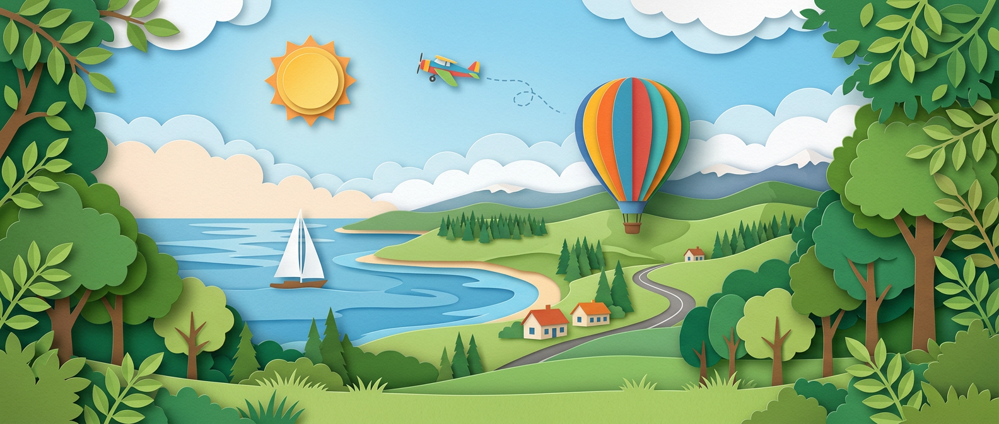
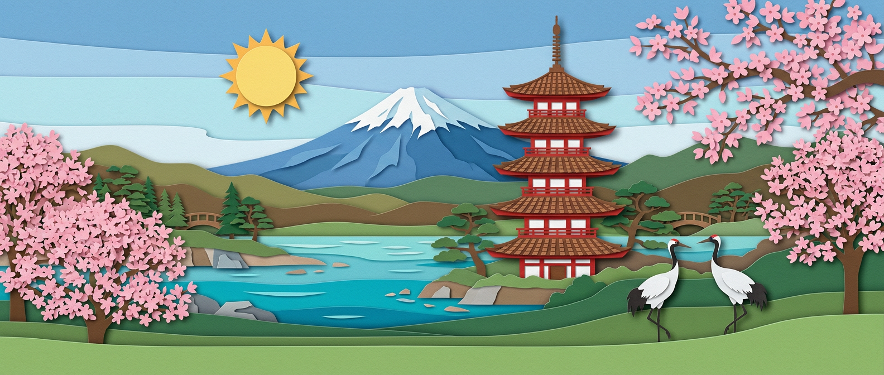

# Papercut World



A paper-cut illustration for every country and territory in the world —
249 ISO 3166-1 codes plus Kosovo — all in one consistent style, plus regional
scenes and a generic travel scene.

Each image is a wide panorama of the place's landmarks, landscape and wildlife,
drawn as a layered paper-cut diorama: stacked coloured cardstock, soft shadows
between the layers, and a paper sun.

## Contents

All images live under `papercuts/`:

| Path | What | Named by |
| --- | --- | --- |
| `papercuts/countries/` | 251 countries and territories | ISO 3166-1 alpha-2, lowercase: `jp.png`, `gb.png`, `br.png` |
| `papercuts/regions/` | 23 world regions and one global scene | slug: `europe.png`, `latin_america.png`, `global.png` |
| `papercuts/default.png` | A generic travel scene for places without their own image | — |

Two country names aren't plain ISO codes:

- `xk.png` is Kosovo. `XK` is the code in common use, but ISO has not assigned it.
- `an.png` is Bonaire. `AN` (Netherlands Antilles) was withdrawn from ISO
  3166-1 in 2010 but is still used by some data sources. `bq.png` covers Saba
  and Sint Eustatius, and `cw.png` and `sx.png` cover Curaçao and Sint Maarten.

Region slugs are lowercase, with words joined by `_`:

| Slug | Region |
| --- | --- |
| `africa`, `asia`, `europe`, `latin_america`, `middle_east`, `north_america` | Continents and large areas |
| `south_east_asia`, `east_asia`, `south_asia`, `central_asia` | Parts of Asia |
| `south_america`, `central_america`, `caribbean` | Parts of the Americas |
| `balkans`, `baltics`, `nordics`, `mediterranean`, `caucasus` | Parts of Europe and its edges |
| `eu_uk` | The European Union and the United Kingdom |
| `gulf`, `mena` | The Gulf states; the Middle East and North Africa |
| `oceania`, `pacific_islands` | Australia and New Zealand; the Pacific islands |
| `global` | The whole world |

## Format

- PNG, 1584 × 672 pixels (21:9).
- Full bleed: no border, frame or text anywhere.
- **No text, letters, flags, logos or watermarks**, so the images work in any
  language and carry no political symbols.

The composition is the same in every image, so they crop and overlay predictably:

- **Top 15%** is plain sky, safe for overlaid UI such as a status bar or back button.
- **Bottom 12%** is plain foreground, safe for a card edge or caption to cover.
- **The main subject** sits in the central band, within the middle ~70% of the
  width, so crops to narrower ratios keep it.

## Use

Link to the raw files, or copy them into your project. For example, with a
fallback for missing codes:

```html

```

The images are large originals. For the web, resize and convert them, for
example to WebP or AVIF at 400–1600 px wide.

## How they were made

The images were generated with an AI image model (Nano Banana 2), all from the
same style block and composition rules. Each place has its own scene
description naming its landmarks, plants and an animal. Every image was
reviewed by hand. The ones showing flags, text, light glows or stray objects
were regenerated.

The full recipe — the fixed style and composition blocks, the scene
grammar and example scenes — is in [prompts.md](prompts.md).

Scenes for sensitive places show landscape and heritage only: no flags,
portraits, soldiers, weapons or damaged buildings.

They are illustrations, not documentation. Landmarks are stylised, combined in
one view and not to scale.

## Licence

MIT — see [LICENSE](LICENSE). The licence covers the images as well as
the documentation.

## Contributing

Spotted a misidentified landmark or an animal that doesn't belong? Open an
issue with the code and what's wrong.
